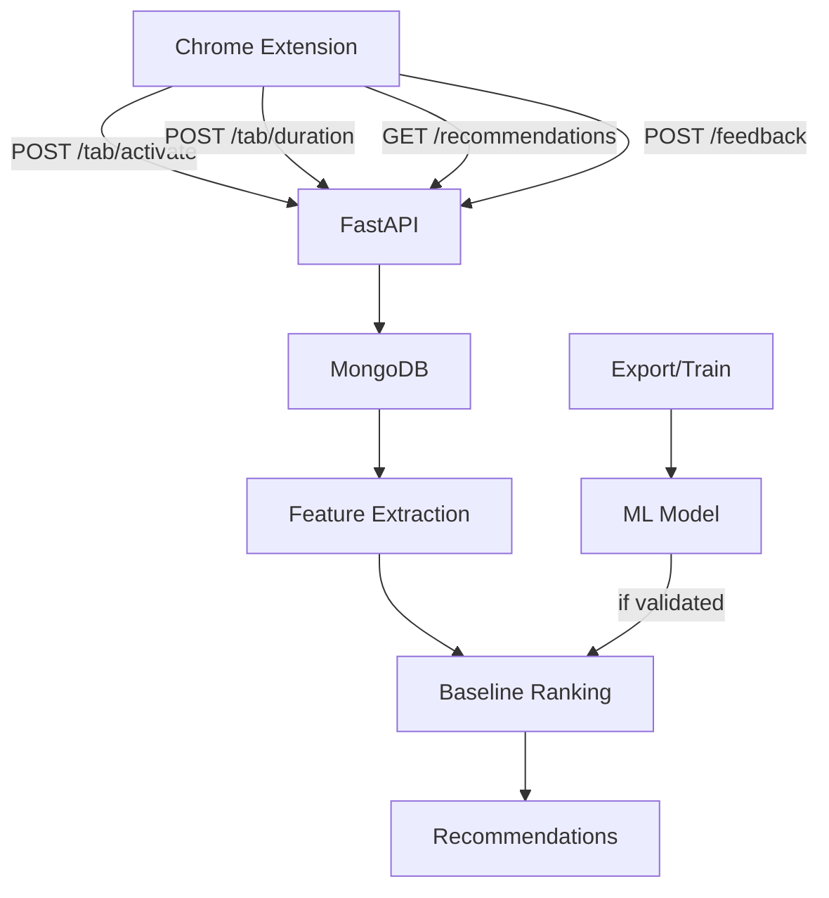

# Asterion

Asterion is a local-first ML-powered browser-tab prioritization assistant. It tracks tab usage, extracts useful features, ranks tabs or domains by relevance, and uses explicit useful/not-useful feedback to improve recommendations when enough valid data exists.

## Overview
- Chrome Manifest V3 extension for tab tracking
- Python FastAPI backend
- MongoDB local storage
- Feature extraction and weighted baseline ranking
- Feedback collection with validation
- Optional ML training (Logistic Regression) when sufficient genuine data exists
- Retro-internet styled UI

## Features
- Automatic tab activation and duration tracking (localhost API only)
- Domain-level engagement ranking
- Explicit feedback (Useful/Not Useful) tied to recommendations
- Data validation and test-data exclusion
- Baseline fallback if model not available/insufficient data
- Self-contained local reports

## Architecture


## Quick Start

### Requirements
- Linux (tested)
- Python 3.12+
- MongoDB running locally on port 27017
- Google Chrome/Chromium

### Setup

1. Create virtual environment and install dependencies:
```bash
cd ~/Desktop/projects/Asterion
python -m venv .venv
source .venv/bin/activate
pip install -r requirements.txt
```

2. Configure environment:
```bash
cp .env.example .env
# Edit .env for local settings (defaults work for local MongoDB)
```

3. Start MongoDB (if not running):
```bash
mongod --dbpath ~/data/db 2>&1 &
```

4. Start API:
```bash
cd ~/Desktop/projects/Asterion
source .venv/bin/activate
uvicorn api:app --host 127.0.0.1 --port 8000 --reload
```

5. Load Chrome extension:
- Open `chrome://extensions/`
- Enable Developer mode
- Click "Load unpacked"
- Select `~/Desktop/projects/Asterion/extension/`

## Usage
- Browse normally - extension tracks HTTP tabs
- Click extension icon to see rankings and give feedback
- Feedback improves dataset for training when enough genuine examples collected

## Data & ML
- Baseline formula: `0.40*log1p(time)/max_logtime + 0.35*log1p(activations)/max_logact + 0.25*exp(-recency/1800)`
- Training requires genuine v2 feedback (>=20, both labels). Test data excluded.
- If insufficient data, baseline remains active.

## Reports
- HTML: `reports/asterion_statistics.html` (open locally)
- Markdown: `reports/ASTERION_ML_EVALUATION.md`

## Testing
```bash
pytest tests/test_core.py -v
```

## Privacy & Security
- Local-first only
- No secrets in extension
- .env excluded from git
- No private browsing data logged
- Feedback validated before use

## License
Local project - use as appropriate.
